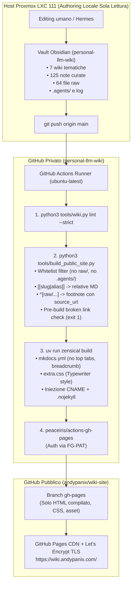

# Pubblicazione della Personal LLM Wiki su GitHub Pages con Zensical

*   **Author:** andypanix (con Hermes)
*   **Status:** Draft
*   **Date:** 2026-10-28

--------------------------------------------------------------------------------

## Overview

Questo progetto trasforma la base di conoscenza personale (`andypanix/personal-llm-wiki`, vault privato Obsidian con 7 wiki tematiche, 125 pagine curate e 64 fonti primarie) in una pubblicazione web statica, pubblica e ad altissime prestazioni ospitata su **GitHub Pages** (`wiki.andypanix.com`).

L'architettura adotta un paradigma serverless Docs-as-Code:
1. L'host locale Proxmox LXC 111 rimane un ambiente di puro authoring privato (Git + Obsidian + script CLI di verifica), eliminando ogni servizio web residente (container Docker, Nginx, reverse proxy, timer systemd e runtime Node.js).
2. Il repository privato della wiki ospita un workflow GitHub Actions che intercetta i push su `main`, azzerando i rischi di interferenza con la memoria RAM dell'agente Hermes.
3. Uno script Python di staging dedicato (`tools/build_public_site.py`) realizza un **airgap deterministico a whitelist**: esclude categoricamente le trascrizioni integrali private (`raw/`), i log interni e i prompt (`.agents/`), converte gli 804 wikilink `[[slug|alias]]` in collegamenti Markdown relativi, trasforma i 1.492 marcatori `^[raw/...]` in note bibliografiche con collegamento esterno al `source_url` originale (YouTube o articoli) e arresta la pipeline con codice 1 se rileva link orfani o rotti.
4. Il generatore statico **Zensical** (il successore in Rust/Python di Material for MkDocs) compila le sole pagine curate applicando un foglio di stile minimale **Typewriter** (`extra.css`), orientato alla lettura serale su smartphone (375 px) con palette carta/inchiostro, senza schede superiori e con breadcrumb a 4 livelli.
5. L'output compilato viene distribuito automaticamente su un repository pubblico dedicato (`andypanix/wiki-site`) tramite un Fine-Grained Personal Access Token (FG-PAT) con privilegi strettamente limitati e servito sulla radice `/` del dominio personalizzato.

--------------------------------------------------------------------------------

## The Problem

### Il contesto d'uso reale
La consultazione primaria della wiki avviene di sera da smartphone (schermo da 375 px) in sessioni da 20-30 minuti: atterraggio sulla home, selezione di una wiki, lettura di una pagina curata, salto su due o tre wikilink, verifica occasionale della fonte primaria e ritorno rapido tramite gesture o breadcrumb.

### I limiti della visualizzazione corrente su GitHub Mobile
Oggi l'unico modo per consultare la wiki da smartphone è il browser sul repository GitHub privato, che degrada completamente l'esperienza:
- **Wikilink non navigabili**: gli 804 collegamenti `[[slug|Titolo]]` rimangono testo piano; non possono essere toccati per navigare.
- **Frontmatter invasivo**: i metadati YAML compaiono come tabelle grezze in cima alla pagina prima del titolo.
- **Fonti disconnesse**: i 1.492 marcatori `^[raw/...]` restano stringhe tra parentesi quadre; non rimandano né alla trascrizione né alla fonte primaria web.
- **Assenza di gerarchia contestuale**: chi atterra su una pagina da una ricerca non sa in quale delle 7 wiki si trovi né come risalire senza usare ripetutamente il tasto indietro del browser.

### Perché il piano originale (Docker locale su LXC 111) era sovradimensionato e fragile
Il piano iniziale prevedeva un container Docker Nginx locale su LXC 111, timer systemd di sincronizzazione ogni 15 minuti, script di reload e accesso limitato a LAN/Tailscale. Quel modello presentava difetti strutturali:
1. **Rischio OOM per Hermes**: l'LXC dispone di 4 GB di RAM e swap disattivato; Hermes ne occupa ~1,3 GB. Un processo di build e demoni residenti concorrenti rischiavano di innescare l'OOM killer sul processo primario dell'agente.
2. **Superficie operativa e porte esposte**: mantenere reverse proxy, certificati SSL locali e container web per consultare 622 kB di testo da parte di una sola persona introduceva un debito operativo ingiustificato.
3. **Dipendenza da Tailscale per la consultazione**: l'accesso dal telefono richiedeva di mantenere attiva la VPN Tailscale o di trovarsi fisicamente sulla LAN domestica.

La soluzione consiste nello spostare compilazione e hosting sui servizi gestiti di GitHub (Actions + Pages), dismettendo ogni componente locale.

--------------------------------------------------------------------------------

## Goals

*   **G1 — Airgap e Whitelist dei Contenuti**: Pubblicare esclusivamente le categorie curate (`entities/`, `concepts/`, `comparisons/`, `queries/`) e le home/indici. Escludere categoricamente e a livello di staging `raw/`, `.agents/`, `log.md` e qualsiasi file non autorizzato.
*   **G2 — Risoluzione Integrale dei Wikilink**: Convertire il 100% degli 804 wikilink interni e dei 180 link cross-wiki in collegamenti Markdown standard relativi (`[alias](../section/slug.md)`), garantendo che tutti i percorsi puntino a file validi.
*   **G3 — Citazioni Esterne Cliccabili**: Trasformare tutti i 1.492 marcatori `^[raw/...]` in note bibliografiche a piè di pagina con hyperlink al `source_url` originale (video YouTube, articoli web) arricchiti da autore e titolo. Convertire i 15 marcatori `^[general-knowledge]` in note descrittive non cliccabili.
*   **G4 — Quality Gate Bloccante**: Eseguire una scansione di integrità prima della compilazione. Se viene rilevato anche un solo link Markdown orfano o un marcatore non risolto, lo script esce con codice 1, interrompendo il deploy su GitHub Pages.
*   **G5 — Zero Infrastruttura sull'Host LXC 111**: Nessun container Docker, nessun server Nginx, nessun timer systemd e nessun runtime Node.js installato o in esecuzione sulla macchina Proxmox. L'LXC resta client di authoring puro.
*   **G6 — Esperienza Mobile Typewriter (375 px)**: Homepage responsive a 7 card (una per dominio), assenza di schede superiori orizzontali (`no top tabs`), breadcrumb gerarchico a 4 livelli (`Home › Wiki › Sezione › Pagina`) e tema tipografico editoriale carta/inchiostro via `extra.css`.
*   **G7 — Deploy Cross-Repo Gratuito su Dominio Personalizzato**: Distribuzione automatica dell'HTML compilato su repository pubblico dedicato (`andypanix/wiki-site`) via Fine-Grained Personal Access Token (FG-PAT), servito su `https://wiki.andypanix.com/` su radice `/`.

--------------------------------------------------------------------------------

## Non-Goals

*   **NG1 — Nessuna pubblicazione del testo integrale di `raw/`**: I 64 file raw con trascrizioni integrali rimangono confinati nel repository privato; il sito pubblico espone solo i collegamenti alle fonti primarie esterne.
*   **NG2 — Nessun runtime o webserver locale**: Nessun demone Nginx o processo di compilazione viene eseguito sull'host LXC.
*   **NG3 — Nessun grafo globale interattivo**: La navigazione privilegia l'albero gerarchico, la ricerca istantanea e i wikilink contestuali, escludendo canvas o visualizzazioni a grafo pesanti su mobile.
*   **NG4 — Nessun sistema di autenticazione o gestione utenti**: Il sito pubblico compilato è liberamente accessibile senza login.
*   **NG5 — Nessuna funzionalità di editing da web**: Obsidian sul vault privato rimane l'unico ambiente di scrittura; il sito pubblico è una vista compilata in sola lettura.

--------------------------------------------------------------------------------

## Open Questions

*   **Q1 — Tempi di propagazione DNS e rilascio TLS su `wiki.andypanix.com`**: GitHub Pages richiede la verifica del record CNAME e l'emissione del certificato Let's Encrypt tramite challenge automatica. Durante i primi minuti di configurazione il certificato potrebbe non essere attivo.
*   **Q2 — Gestione della scadenza del Fine-Grained PAT (365 giorni)**: I token FG-PAT hanno validità massima di 1 anno. È opportuno documentare una procedura di rotazione annuale nei metadati della CI per prevenire fallimenti imprevisti del deploy al giorno 366.

--------------------------------------------------------------------------------

## Critical User Journeys (CUJs)

### CUJ 1: Lettura serale da smartphone (375 px) e navigazione per wikilink
*   **Given**: L'utente apre `https://wiki.andypanix.com/` dal browser dello smartphone (schermo 375 px).
*   **When**: Tocca la card del dominio `ai-llm`, entra nell'indice, apre la pagina curata `elephant-goldfish-model` e tocca un wikilink verso un'altra entità.
*   **Then**: La pagina si legge senza scorrimento orizzontale del testo, la tipografia Typewriter mantiene una riga di lettura leggibile e riposante, il wikilink atterra direttamente sulla pagina collegata e il breadcrumb in testa consente di risalire con un tocco all'indice della wiki o alla Home.

### CUJ 2: Verifica della fonte primaria di un'affermazione tecnica
*   **Given**: L'utente sta leggendo una pagina curata contenente affermazioni estratte da un talk o articolo tecnico.
*   **When**: Tocca l'apice numerato della citazione `[1]`.
*   **Then**: La vista scorre alla sezione "Fonti" a piè di pagina, dove trova il titolo del talk, l'autore e un link esterno diretto al video YouTube o all'articolo originale (`source_url`), apribile in una nuova scheda senza abbandonare la lettura.

### CUJ 3: Ricerca istantanea trasversale con folding degli accenti
*   **Given**: L'utente è su una qualsiasi pagina del sito e cerca un termine senza sapere in quale delle 7 wiki si trovi.
*   **When**: Apre la barra di ricerca e digita una parola (es. "perche" senza accento).
*   **Then**: Il motore client-side di Zensical restituisce i risultati istantaneamente evidenziando le occorrenze sia per "perché" che per "perche", indicando chiaramente il dominio di appartenenza di ogni pagina trovata.

### CUJ 4: Rilevamento e blocco in CI di un link interno rotto
*   **Given**: L'utente o un agente aggiunge una nota su `main` di `personal-llm-wiki` inserendo un wikilink errato `[[slug-inesistente]]`.
*   **When**: La GitHub Action si avvia ed esegue lo script di staging `build_public_site.py`.
*   **Then**: Lo script rileva il bersaglio mancante, stampa l'errore `file:line: broken link to slug-inesistente` e termina con codice 1; la pipeline si arresta immediatamente e nessuna versione con link rotti viene pubblicata su `wiki.andypanix.com`.


--------------------------------------------------------------------------------

## Technical Plan (Architecture)

### 1. Forma del sistema e Flusso dei Dati

L'architettura separa rigorosamente l'ambiente di authoring (privato e locale sull'LXC 111) dalla pipeline di compilazione e hosting (interamente cloud, serverless e basata sui servizi gestiti di GitHub).



---

### 2. Lo Script di Staging: `tools/build_public_site.py`

Lo script Python opera come **airgap logico e motore di trasformazione deterministico** prima dell'invocazione del generatore statico. La sua esecuzione è strutturata in quattro fasi sequenziali:

#### Fase A: Indicizzazione Globale e Mappatura delle Fonti
1. **Mappa globale degli slug**:
   Scansiona tutte le cartelle ammesse (`entities/`, `concepts/`, `comparisons/`, `queries/`) delle 7 wiki.
   Costruisce una tabella in-memory:
   `slug_map[slug] = {"wiki": wiki_name, "category": cat, "relpath": "wiki/cat/slug.md", "title": frontmatter_title}`.
   Poiché `tools/wiki.py` già garantisce l'univocità degli slug a livello di vault, la mappatura è deterministica e biunivoca.
2. **Mappa delle sorgenti primarie (`raw/`)**:
   Scansiona i 64 file in `*/raw/transcripts/` e `*/raw/articles/`.
   Estrae dal frontmatter YAML: `source_url`, `author`, `title`.
   Costruisce il dizionario `raw_map[raw_relative_path] = {"url": url, "author": author, "title": title}`.
   I file raw **non vengono mai copiati** nella cartella di staging.

#### Fase B: Staging a Whitelist Rigida (Default-Deny)
Lo script crea una directory temporanea `staged_site/docs/`.
Vengono copiate e processate **esclusivamente** le directory esplicite:
- `entities/`
- `concepts/`
- `comparisons/`
- `queries/`
- File `index.md` di ciascuna wiki (riadattato per Zensical).

Tutto il resto (`raw/`, `.agents/`, `log.md`, file di configurazione locali, appunti) viene escluso alla radice, azzerando qualsiasi rischio di data leak di informazioni private o non curate.

#### Fase C: Trasformazione Sintattica dei Contenuti
Su ogni file `.md` ammesso vengono applicate le seguenti regole di riscrittura:
1. **Wikilink Obsidian (`[[slug]]` e `[[slug|alias]]`)**:
   - Ricerca dello slug in `slug_map`.
   - Se trovato: calcolo del percorso relativo standard tramite `os.path.relpath(target_path, current_dir)`.
   - Generazione di `[alias](relative_path.md)`.
2. **Marcatori di Citazione (`^[raw/...]`)**:
   - Regex: `\^\[(raw/(?:transcripts|articles)/[^\]]+)\]`
   - Ricerca del file raw in `raw_map`.
   - Sostituzione inline nel testo con richiamo a footnote numerata progressiva per pagina: `[^cit-N]`.
   - Generazione della sezione note a fondo pagina:
     `[^cit-N]: Fonte: [{title}]({source_url}) ({author}) ↗`
3. **Marcatori General Knowledge (`^[general-knowledge]`)**:
   - Sostituzione con nota testuale in calce: `[^gk-N]`.
   - Testo footnote: `[^gk-N]: *Dato fattuale consolidato di dominio (senza fonte primaria singola).*`
4. **Pulizia Frontmatter**:
   - Rimozione delle chiavi Obsidian non rilevanti per il sito web.
   - Conservazione dei metadati editoriali (`title`, `updated`, `confidence`, `tags`).

#### Fase D: Quality Gate Deterministico sui Link (Pre-build Link Verification)
Prima di avviare Zensical, lo script esegue un audit completo su tutti i link Markdown generati:
- Estrae tutti i collegamenti `[testo](target)`.
- Ignora URL esterni (`http://`, `https://`, `mailto:`) e ancore locali (`#`).
- Risolve il percorso target rispetto alla directory di staging e verifica l'esistenza del file su disco con `os.path.exists()`.
- Se uno o più file risultano inesistenti:
  - Stampa a video la lista dettagliata delle violazioni (`ERRORE: broken link in file.md:line -> target.md`).
  - Esegue `sys.exit(1)`, interrompendo immediatamente il workflow di GitHub Actions prima del build e del deploy.

---

### 3. Architettura Grafica e Navigazione in Zensical

#### Configurazione `mkdocs.yml`
La configurazione sfrutta la compatibilità Zensical con il tema Material:
```yaml
site_name: Personal LLM Wiki
site_url: https://wiki.andypanix.com/
site_description: "Knowledge base curata su 7 domini tecnici (stile Karpathy LLM-Wiki)"
repo_url: https://github.com/andypanix/wiki-site

theme:
  name: material
  language: it
  palette:
    - media: "(prefers-color-scheme: light)"
      scheme: default
      primary: custom
      accent: custom
    - media: "(prefers-color-scheme: dark)"
      scheme: slate
      primary: custom
      accent: custom
  font:
    text: Newsreader
    code: JetBrains Mono
  features:
    - navigation.path       # Breadcrumb a 4 livelli
    - navigation.indexes    # Indici cartella associati alla sezione
    - navigation.tracking   # TOC dinamica durante lo scroll
    - navigation.top        # Pulsante rapido Torna su
    - search.suggest        # Ricerca full-text istantanea
    - search.highlight      # Evidenziazione termini cercati
    - content.code.copy     # Copia blocchi di codice
  # navigation.tabs: false  OMESSO per eliminare le schede superiori

extra_css:
  - extra.css

markdown_extensions:
  - admonition
  - pymdownx.details
  - pymdownx.superfences
  - pymdownx.inlinehilite
  - footnotes
  - attr_list
  - tables
```

#### Homepage a 7 Card (`docs/index.md`)
Generata automaticamente dallo script di staging, la Home espone una griglia CSS responsiva (`.wiki-grid`):
- 7 card dedicate ai domini del vault: `ai-llm`, `devops`, `finanza-personale`, `homelab`, `software-engineering`, `tech-economy`, `tech-strategy`.
- Ciascuna card include: titolo del dominio, abstract esplicativo, badge contatore delle pagine curate e data dell'ultimo aggiornamento.
- Toccando la card si atterra direttamente nell'indice di quella wiki.

#### Breadcrumb Gerarchico a 4 Livelli
Grazie alla feature `navigation.path` e alla struttura a cartelle:
- Struttura: `Home › [Nome Wiki] › [Categoria] › [Titolo Pagina]`
- Esempio: `Home › AI & LLM › Concetti › Elephant-Goldfish Model`
- Reso con corpo ridotto e font monospaziato discreto, consente di risalire la gerarchia con un solo tocco a 375 px su mobile.

#### Foglio di Stile Typewriter (`docs/extra.css`)
- **Tipografia**: corpo del testo in serif editoriale (`Newsreader` / `Charter`), font size 1.05rem, line-height 1.75; intestazioni `h1-h4`, metadati, breadcrumb e codice in monospace (`JetBrains Mono`).
- **Palette Carta/Inchiostro**:
  - Light mode: fondo avorio caldo (`#fcfbf9`), testo inchiostro scuro (`#1a1a1c`), bordi e divisori a basso contrasto (`#e5e2d8`).
  - Dark mode (slate): fondo carbone caldo (`#161617`), testo crema chiaro (`#e3e1d8`), bordi scuri (`#2c2c2f`).
- **Larghezza colonna contenuta**: larghezza massima di lettura vincolata a 700 px (evitando dispersione ottica su desktop e garantendo fluidità totale a 375 px su smartphone).

---

### 4. Pipeline CI/CD e Modello di Deploy Cross-Repository

Il workflow `.github/workflows/deploy.yml` nel repository privato `personal-llm-wiki` esegue i seguenti passi:

1. **Trigger**:
   - `on: push` sul branch `main`.
   - `on: workflow_dispatch` (per trigger manuale o rigenerazione).
   - `concurrency: group: "pages-deploy", cancel-in-progress: true` (evita esecuzioni concorrenti).
2. **Ambiente**:
   - Runner `ubuntu-latest`.
   - Installazione Python 3.12 rapida tramite `astral-sh/setup-uv@v3`.
3. **Quality Gates**:
   - Linting delle convenzioni del vault: `python3 tools/wiki.py lint --strict`.
   - Esecuzione dello script di staging e validazione link: `python3 tools/build_public_site.py --source . --output staged_site`. Se fallisce, il job si arresta.
4. **Compilazione Zensical**:
   - Installazione dipendenze: `uv pip install --system zensical pyyaml`.
   - Compilazione statica: `zensical build --clean --config-file staged_site/mkdocs.yml --site-dir public_dist`.
5. **Asset di Servizio**:
   - Creazione file `public_dist/CNAME` con valore `wiki.andypanix.com`.
   - Creazione file vuoto `public_dist/.nojekyll` per inibire il parsing Jekyll di GitHub Pages.
6. **Deploy Cross-Repo via Fine-Grained PAT**:
   - Utilizzo dell'action consolidata `peaceiris/actions-gh-pages@v4`.
   - Autenticazione tramite Secret `PUBLIC_WIKI_DEPLOY_TOKEN` (Fine-Grained PAT con scope limitato al solo repo `andypanix/wiki-site` con permessi `Contents: Read and Write`).
   - Push atomico dell'HTML compilato sul branch `gh-pages` del repository pubblico.
7. **Erogazione CDN**:
   - GitHub Pages sul repository pubblico serve il branch `gh-pages` su `https://wiki.andypanix.com/` con certificato TLS gestito automaticamente.

---

### 5. Dismissione dell'Infrastruttura Locale (LXC 111)

Con l'attivazione della pipeline cloud:
- Vengono archiviati o eliminati i file di configurazione Docker (`Dockerfile`, `compose.yml`, `nginx.conf`) e le unità di timer systemd (`wiki-site-publish.service`, `wiki-site-watch.service`).
- Sull'host LXC 111 non rimane alcun processo attivo legato alla wiki: zero porte aperte, zero consumo di memoria RAM e zero demoni da monitorare.


--------------------------------------------------------------------------------

## Alternatives Considered

### Alternative A: Hosting locale in container Docker su Proxmox LXC 111 (Architettura originale)
*   **Pros**: Contenuti confinati nella rete privata; nessuna esposizione su Internet; nessun token o credenziale esterna necessaria.
*   **Cons**:
    - **Rischio OOM**: consumo di memoria RAM continuo su un host con 4 GB e swap a 0, condiviso con l'agente Hermes (~1,3 GB di footprint), con rischio concreto di terminazione del processo primario.
    - **Debito operativo**: gestione di porte aperte su LAN, reverse proxy Nginx locale, certificati Let's Encrypt interni, unità systemd di publish e watcher per 622 kB di testo.
    - **Fragilità dello swap atomico**: lo swap atomico di directory via symlink `current` si rompe con i bind mount predefiniti di Docker senza artifici complessi di montaggio parent.
*   **Reason for Rejection**: Complessità architetturale e rischio operativo eccessivi per un sito di lettura personale, risolti alla radice delegando hosting e build ai servizi cloud gestiti di GitHub.

### Alternative B: Quartz v4 (SSG nativo per Obsidian in TypeScript/Node)
*   **Pros**: Supporto nativo e integrato per wikilink `[[slug]]`, backlink automatici, callout Obsidian e grafi locali senza dipendenze o script intermedi.
*   **Cons**:
    - Introduce una toolchain Node.js (`package.json`, `node_modules`, runtime Node 20) in un ecosistema in cui il vault è interamente gestito con script Python (`tools/wiki.py`).
    - Configurazione complessa e vincolata a TypeScript (`quartz.config.ts`, `quartz.layout.ts`).
*   **Reason for Rejection**: Rifiutato su indicazione esplicita dell'utente, orientato a non introdurre toolchain Node.js nel proprio stack e a valorizzare l'esperienza e l'adozione già attiva di Zensical in produzione.

### Alternative C: Integrazione nel blog personale Hugo (`andypanix/static-personal-blog-website`)
*   **Pros**: Riutilizzo dell'infrastruttura di hosting e del dominio principale `andypanix.com` già attivo.
*   **Cons**:
    - **Incompatibilità dei motori di Markdown**: Hugo non supporta nativamente la sintassi Obsidian (`[[slug|alias]]`, marcatori `^[raw/...]`); richiederebbe complessi render hooks Go custom o shortcode ad hoc.
    - **Accoppiamento di cicli di vita divergenti**: il blog è un archivio statico con pubblicazioni saltuarie e storiche; la wiki è un corpus vivo aggiornato frequentemente dagli agenti.
    - **Divergenza di UX**: un blog privilegia la consultazione sequenziale cronologica; una wiki richiede navigazione a rete con breadcrumb gerarchici profondi e indici per dominio.
*   **Reason for Rejection**: L'adattamento avrebbe introdotto frizioni continue nella manutenzione del blog e rischi di rottura ad ogni commit della wiki.

### Alternative D: Material for MkDocs 9.8.0 standard
*   **Pros**: Ecosistema Python maturo; comportamento verificato nel prototipo iniziale.
*   **Cons**:
    - Il progetto Material for MkDocs ha annunciato la fine vita ufficiale per il **5 maggio 2027**, designando Zensical come successore.
    - L'engine sottostante MkDocs 1.6.1 è in stallo conservativo e non introduce innovazioni architetturali.
*   **Reason for Rejection**: Zensical mantiene piena retro-compatibilità con le configurazioni di Material offrendo un runtime Rust molto più veloce e un ciclo di vita attivo e a lungo termine.

### Alternative E: Deploy Key SSH al posto del Fine-Grained Personal Access Token (FG-PAT)
*   **Pros**: Nessuna scadenza obbligatoria (il token FG-PAT scade ogni 365 giorni); isolamento assoluto vincolato al singolo repository di destinazione.
*   **Cons**: Richiede la generazione manuale di coppie di chiavi SSH, configurazione di host key e gestione manuale delle impostazioni repository.
*   **Reason for Rejection**: L'utente ha espresso preferenza per il Fine-Grained PAT per immediatezza di gestione, accettando il promemoria operativo di rigenerazione annuale del secret.

### Alternative F: Pubblicazione integrale del testo delle sorgenti raw (`raw/`)
*   **Pros**: I collegamenti alle fonti atterrano su pagine interne HTML della wiki.
*   **Cons**:
    - **Rischio copyright**: ridistribuzione pubblica non autorizzata di trascrizioni integrali di video YouTube e articoli protetti da copyright.
    - **Gonfiamento dell'indice di ricerca**: l'indice client-side supererebbe i 2,4 MB (800 kB compressi), degradando le prestazioni su mobile.
    - **Rumore informativo**: mescolerebbe note di sintesi curate ad alto valore aggiunto con trascrizioni automatiche grezze di 40 minuti di conferenza.
*   **Reason for Rejection**: Escludere i file `raw/` e convertire le citazioni nei corrispondenti `source_url` esterni elimina il rischio legale, alleggerisce l'indice e offre attribuzione trasparente all'autore originale.

--------------------------------------------------------------------------------

## Non-Functional Requirements

### Security & Privacy
*   **Airgap a Whitelist**: La pipeline di staging implementa una whitelist rigida (`entities/`, `concepts/`, `comparisons/`, `queries/`). Nessun file in `.agents/`, `raw/`, né file di log o configurazione privata può raggiungere il repository pubblico.
*   **Principio del Minimo Privilegio (Least Privilege)**: Il Fine-Grained PAT dispone unicamente dei permessi `Contents: Read and write` sul solo repository pubblico `andypanix/wiki-site`. Non ha alcun diritto di lettura o scrittura sul vault privato `personal-llm-wiki` né su altri progetti.
*   **Nessun dato finanziario o personale**: È stato certificato che la wiki `finanza-personale` contiene esclusivamente note concettuali/educative per risparmiatori italiani e nessun dato patrimoniale personale.

### Performance & Client-Side Budget
*   **Budget dell'Indice di Ricerca**: Escludendo le raw, l'indice di ricerca Zensical copre ~970 sezioni su 125 pagine curate, con un peso inferiore a **220 kB compressi** (perfettamente entro la soglia di reattività per smartphone su rete cellulare).
*   **Tempo di Build in CI**: Il build Zensical e lo script Python impiegano complessivamente meno di **25-30 secondi** su GitHub Actions, consumando meno di 1 minuto del plafond mensile per ogni push su `main`.
*   **Resa su Mobile (375 px)**: Nessuno scorrimento orizzontale del testo (larghezza riga limitata a 700 px con margine automatico); rimozione della TOC laterale su mobile per massimizzare lo spazio verticale.

### Rollout, Rollback & SRE Operativo
*   **Rollback Istantaneo in caso di Guasto**: Se un commit introduce errori o incoerenze, GitHub Actions arresta la pipeline allo step di test/validazione (`exit 1`), lasciando online su GitHub Pages l'ultima release valida senza alcuna degradazione del servizio.
*   **Rollback Manuale**: In caso di necessità di revert, è sufficiente un normale `git revert` sul branch `main` del vault privato per innescare la compilazione e il deploy della versione precedente.


--------------------------------------------------------------------------------

## Detailed Implementation Plan

La transizione all'architettura serverless Zensical + GitHub Pages è strutturata in un piano operativo unificato che interessa il repository privato del vault (`personal-llm-wiki`), il nuovo repository pubblico di distribuzione (`andypanix/wiki-site`) e le configurazioni esterne (DNS e credenziali).

### Target Files to Create / Modify / Delete

#### Repository `personal-llm-wiki` (Vault Privato)

##### 1. `tools/build_public_site.py` (Create)
*   **Type / Scope**: Script CLI Python (standard library + `pyyaml`) per staging, trasformazione e validazione.
*   **Proposed Changes**:
    - **Fase 1 (Slug Indexing)**: Scansiona tutte le cartelle curate (`entities/`, `concepts/`, `comparisons/`, `queries/`) delle 7 wiki; popola la mappa globale in-memory `slug_map[slug] = (wiki, tipo, path_relativo, titolo)`. Fallisce se rileva slug duplicati.
    - **Fase 2 (Raw Source Extraction)**: Scansiona i 64 file in `*/raw/transcripts/` e `*/raw/articles/`; estrae dal frontmatter YAML `source_url`, `author`, `title` e costruisce `raw_map[raw_path]`.
    - **Fase 3 (Whitelist Staging & Transformation)**:
      - Crea la cartella `staged_site/docs/`.
      - Copia unicamente i file appartenenti alle directory consentite (`entities`, `concepts`, `comparisons`, `queries`) escludendo categoricamente `raw/`, `.agents/`, `log.md` e file non tracciati.
      - Converte i wikilink `[[slug]]` e `[[slug|alias]]` in percorsi relativi Markdown `[alias](../section/slug.md)` usando `os.path.relpath`.
      - Converte i marcatori `^[raw/...]` in apici numerati per pagina `[^cit-N]` e appende la sezione note bibliografiche con link esterno al `source_url`.
      - Converte i marcatori `^[general-knowledge]` in note a piè di pagina descrittive non cliccabili.
      - Ripulisce il frontmatter dai campi non necessari conservando `title`, `updated`, `confidence`, `tags`.
    - **Fase 4 (Quality Gate di Integrità)**:
      - Ispeziona tutti i link Markdown generati `[text](target)`.
      - Verifica l'esistenza fisica del file bersaglio nella cartella di staging.
      - Se rileva uno o più link rotti: stampa `file:line: broken link -> target` ed esce con `sys.exit(1)`.
    - **Fase 5 (Homepage & Config Assembly)**:
      - Genera automaticamente `staged_site/docs/index.md` con la griglia CSS a 7 card rappresentanti le 7 wiki con relativi metadati e contatori.
      - Copia `templates/mkdocs.yml` in `staged_site/mkdocs.yml` e `templates/extra.css` in `staged_site/docs/extra.css`.

##### 2. `templates/mkdocs.yml` (Create)
*   **Type / Scope**: File di configurazione per Zensical / MkDocs.
*   **Proposed Changes**:
    - Configura `site_name`, `site_url: https://wiki.andypanix.com/`, `theme: name: material`.
    - Disabilita esplicitamente le top tabs (omissione di `navigation.tabs`).
    - Abilita `navigation.path` per breadcrumb gerarchico a 4 livelli, `navigation.indexes` per gli indici di cartella e `navigation.tracking` per TOC dinamica.
    - Configura palette carta/inchiostro (light/slate) e imposta i font (`Newsreader` per il testo, `JetBrains Mono` per codice e titoli).
    - Dichiara `extra_css: [extra.css]` e le estensioni Markdown necessarie (`admonition`, `footnotes`, `tables`, `attr_list`, `pymdownx.details`).

##### 3. `templates/extra.css` (Create)
*   **Type / Scope**: Foglio di stile CSS per Zensical (tema Typewriter).
*   **Proposed Changes**:
    - Variabili CSS per light mode: fondo `#fcfbf9`, testo `#1a1a1c`, bordi `#e5e2d8`.
    - Variabili CSS per dark mode (`slate`): fondo `#161617`, testo `#e3e1d8`, bordi `#2c2c2f`.
    - Stile tipografico per `.md-typeset`: font Newsreader/Charter, line-height 1.75, max-width 700 px con centratura orizzontale.
    - Intestazioni `h1-h4`, breadcrumb (`.md-path`), metadati e codice in JetBrains Mono.
    - Regole CSS per la griglia responsive `.wiki-grid` e le tessere `.wiki-card`.
    - Formattazione discreta per gli apici numerati e la sezione note in calce.

##### 4. `.github/workflows/deploy.yml` (Create)
*   **Type / Scope**: Workflow di automazione CI/CD per GitHub Actions.
*   **Proposed Changes**:
    - Esecuzione su push su branch `main` e `workflow_dispatch`.
    - Concurrency group per prevenire deploy concorrenti sovrapposti.
    - Setup rapido Python 3.12 con `astral-sh/setup-uv@v3`.
    - Step 1: Esecuzione linter vault: `python3 tools/wiki.py lint --strict`.
    - Step 2: Esecuzione script di staging: `python3 tools/build_public_site.py --source . --output staged_site`.
    - Step 3: Installazione Zensical (`uv pip install --system zensical pyyaml`) e compilazione statica: `zensical build --clean --config-file staged_site/mkdocs.yml --site-dir public_dist`.
    - Step 4: Creazione di `public_dist/CNAME` (`wiki.andypanix.com`) e `public_dist/.nojekyll`.
    - Step 5: Deploy cross-repository con `peaceiris/actions-gh-pages@v4` autenticato tramite `${{ secrets.PUBLIC_WIKI_DEPLOY_TOKEN }}` sul repo `andypanix/wiki-site` (branch `gh-pages`).

##### 5. `tests/test_build_public_site.py` (Create)
*   **Type / Scope**: Suite di test unitari automatizzati pytest.
*   **Proposed Changes**:
    - `test_slug_indexing()`: verifica che tutti i 125 slug vengano indicizzati correttamente e che slug duplicati sollevino un'eccezione bloccante.
    - `test_raw_source_mapping()`: verifica che tutti i 64 file raw con `source_url` vengano mappati correttamente nel dizionario.
    - `test_wikilink_translation()`: verifica la conversione di `[[slug]]` e `[[slug|alias]]` nei rispettivi percorsi relativi corretti rispetto alla cartella chiamante.
    - `test_citation_marker_translation()`: verifica che `^[raw/...]` diventi una footnote con `source_url` e che `^[general-knowledge]` diventi una nota testuale priva di link.
    - `test_whitelist_airgap()`: verifica che dopo lo staging nessuna directory `raw/` o `.agents/` sia presente nella destinazione.
    - `test_broken_link_quality_gate()`: verifica che la presenza di un link orfano provochi l'uscita con codice 1 e messaggio esplicativo.

---

#### Repository `andypanix/wiki-site` (Repository Pubblico di Hosting)

##### 6. Creazione e Configurazione del Repository Pubblico (Create)
*   **Type / Scope**: Repository GitHub pubblico dedicato all'hosting.
*   **Proposed Changes**:
    - Creazione del repository `andypanix/wiki-site` (visibilità pubblica).
    - Abilitazione di GitHub Pages sotto `Settings > Pages`:
      - Source: *Deploy from a branch*.
      - Branch: `gh-pages` / `/(root)`.
      - Custom domain: `wiki.andypanix.com`.
      - Enforce HTTPS: attivo.
    - Il repository conterrà esclusivamente l'output compilato generato dalla Action (branch `gh-pages`).
    - I file di bozza Docker/Nginx/systemd presenti nella sandbox locale vengono archiviati/eliminati, lasciando il repository pulito e privo di servizi residenti.

---

#### Risorse Esterne: DNS & Credenziali

##### 7. Record DNS CNAME (Create/Configure)
*   **Type / Scope**: Configurazione DNS sul registrar del dominio `andypanix.com`.
*   **Proposed Changes**:
    - Aggiunta record CNAME: `wiki` -> `andypanix.github.io`.
    - Attesa propagazione e generazione automatica del certificato TLS Let's Encrypt da parte di GitHub.

##### 8. Fine-Grained Personal Access Token (Create/Configure)
*   **Type / Scope**: Credenziale di sicurezza GitHub per deploy cross-repository.
*   **Proposed Changes**:
    - Generazione di un FG-PAT sull'account `andypanix` con:
      - Nome: `wiki-pages-deploy-token`.
      - Scadenza: 1 anno (365 giorni).
      - Repository access: *Only select repositories* -> `andypanix/wiki-site`.
      - Permissions: `Repository permissions > Contents: Read and write`.
    - Salvataggio del valore del token nei Secrets del repository privato `personal-llm-wiki` con chiave `PUBLIC_WIKI_DEPLOY_TOKEN`.

---

### Verification Plan

#### 1. Validazione Locale e Test Unitari
*   **Esecuzione Linter Esistente**:
    ```bash
    cd /root/development/llm-wiki
    python3 tools/wiki.py lint --strict
    ```
    *Criterio di successo*: 0 errori e 0 warning.
*   **Esecuzione Test Unitari dello Script di Staging**:
    ```bash
    pytest tests/test_build_public_site.py -v
    ```
    *Criterio di successo*: tutti i test passano (indicizzazione slug, risoluzione wikilink, citazioni esterne, blocco link orfani ed esclusione raw).

#### 2. Collaudo del Build Locale
*   **Esecuzione Pipeline di Staging e Compilazione**:
    ```bash
    python3 tools/build_public_site.py --source . --output staged_site
    uv run zensical build --clean --config-file staged_site/mkdocs.yml --site-dir public_dist
    ```
    *Criteri di successo*:
    - Output statico generato senza errori di compilazione Zensical.
    - Zero file `raw/` o `.agents/` presenti in `public_dist/`.
    - Indice di ricerca `search_index.json` con dimensione compressa inferiore a 250 kB.
    - Scansione regex dell'HTML generato: zero occorrenze residue di `[[` o `^[`.

#### 3. Test di Iniezione Guasto (Fail-Closed Gate)
*   Creazione temporanea di una nota di test contenente `[[slug-totalmente-inesistente]]`.
*   Esecuzione di `python3 tools/build_public_site.py`:
    *Criterio di successo*: lo script intercetta il link orfano, stampa l'errore a terminale ed esce con codice 1, senza generare la directory di staging.

#### 4. Integrazione End-to-End su GitHub Actions & Pages
*   Commit e push sul branch `main` del repository privato.
*   Verifica dell'esecuzione del workflow su GitHub Actions:
    - Step di staging e build verdi.
    - Deploy su branch `gh-pages` del repo pubblico completato con successo.
*   Verifica HTTP e TLS su browser:
    - `curl -sI https://wiki.andypanix.com/` restituisce HTTP 200 con certificato TLS valido.
    - Verifica da smartphone (375 px): apertura della Home a 7 card, consultazione di una pagina curata, tocco di un wikilink e risalita rapida via breadcrumb senza alcuno scorrimento orizzontale.
    - Verifica footnote: tocco di un apice `[1]` e apertura in nuova scheda del video YouTube o articolo sorgente (`source_url`).

--------------------------------------------------------------------------------

<!-- Provenance: Indicates initial structural drafting via EGM. -->

*Drafted with EGM*
