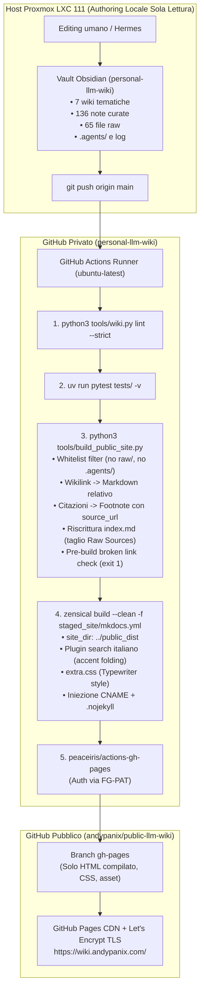

# Pubblicazione della Personal LLM Wiki su GitHub Pages con Zensical

*   **Author:** andypanix (con Hermes)
*   **Status:** Proposed
*   **Date:** 2026-10-28

---

## Overview

Questo progetto trasforma la base di conoscenza personale (`andypanix/personal-llm-wiki`, vault privato Obsidian con 7 wiki tematiche, 136 pagine curate e 65 fonti primarie raw) in una pubblicazione web statica, pubblica e ad altissime prestazioni ospitata su **GitHub Pages** (`https://wiki.andypanix.com/`).

L'architettura adotta un paradigma serverless Docs-as-Code:
1. L'host locale Proxmox LXC 111 rimane un ambiente di puro authoring privato (Git + Obsidian + script CLI di verifica), eliminando ogni servizio web residente (container Docker, Nginx, reverse proxy, timer systemd e runtime Node.js).
2. Il repository privato della wiki ospita un workflow GitHub Actions che intercetta i push su `main`, azzerando i rischi di interferenza con la memoria RAM dell'agente Hermes.
3. Uno script Python di staging dedicato (`tools/build_public_site.py`) realizza un **airgap deterministico a whitelist**: esclude categoricamente le trascrizioni integrali private (`raw/`), i log interni e i prompt (`.agents/`), converte i wikilink `[[slug|alias]]` in collegamenti Markdown relativi standard, trasforma i marcatori di provenienza `^[raw/...]` e cross-wiki `^[../<wiki>/raw/...]` in note bibliografiche esterne con link al `source_url` originale (YouTube o articoli web) e arresta la pipeline con codice 1 se rileva link orfani o rotti.
4. Il generatore statico **Zensical** (successore in Rust/Python di Material for MkDocs) compila le sole pagine curate applicando un foglio di stile minimale **Typewriter** (`extra.css`), orientato alla lettura serale su smartphone (375 px) con palette carta/inchiostro, senza schede superiori e con breadcrumb gerarchico a 4 livelli.
5. L'output compilato viene distribuito automaticamente su un repository pubblico dedicato (`andypanix/public-llm-wiki`) tramite un Fine-Grained Personal Access Token (FG-PAT) con privilegi strettamente limitati e servito sulla radice `/` del dominio personalizzato.

---

## Problem Statement

### Il contesto d'uso reale
La consultazione primaria della wiki avviene di sera da smartphone (schermo da 375 px) in sessioni da 20-30 minuti: atterraggio sulla home, selezione di una wiki, lettura di una pagina curata, navigazione attraverso due o tre wikilink, verifica occasionale della fonte primaria e risalita rapida tramite gesture o breadcrumb.

### I limiti della visualizzazione corrente su GitHub Mobile
Oggi l'unico modo per consultare la wiki da smartphone è il browser sul repository GitHub privato, che degrada completamente l'esperienza:
- **Wikilink non navigabili**: i collegamenti `[[slug|Titolo]]` rimangono testo piano; non possono essere toccati per navigare.
- **Frontmatter invasivo**: i metadati YAML compaiono come tabelle grezze in cima alla pagina prima del titolo.
- **Fonti disconnesse**: i marcatori di citazione restano stringhe tra parentesi quadre; non rimandano né alla trascrizione né alla fonte primaria web.
- **Assenza di gerarchia contestuale**: chi atterra su una pagina da una ricerca non sa in quale delle 7 wiki si trovi né come risalire senza usare ripetutamente il tasto indietro del browser.

### Perché il piano originale (Docker locale su LXC 111) era sovradimensionato e fragile
Il piano iniziale prevedeva un container Docker Nginx locale su LXC 111, timer systemd di sincronizzazione ogni 15 minuti, script di reload e accesso limitato a LAN/Tailscale. Quel modello presentava difetti strutturali:
1. **Rischio OOM per Hermes**: l'LXC dispone di 4 GB di RAM e swap disattivato; Hermes ne occupa ~1,3 GB. Un processo di build e demoni residenti concorrenti rischiavano di innescare l'OOM killer sul processo primario dell'agente.
2. **Superficie operativa e porte esposte**: mantenere reverse proxy, certificati SSL locali e container web per consultare ~650 kB di testo da parte di una sola persona introduceva un debito operativo ingiustificato.
3. **Dipendenza da Tailscale per la consultazione**: l'accesso dal telefono richiedeva di mantenere attiva la VPN Tailscale o di trovarsi fisicamente sulla LAN domestica.

La soluzione consiste nello spostare compilazione e hosting sui servizi gestiti di GitHub (Actions + Pages), dismettendo ogni componente locale.

---

## Goals

*   **G1 — Airgap e Whitelist dei Contenuti**: Pubblicare esclusivamente le categorie curate (`entities/`, `concepts/`, `comparisons/`, `queries/`) e le home/indici. Escludere categoricamente e a livello di staging `raw/`, `.agents/`, `log.md` e qualsiasi file non autorizzato.
*   **G2 — Risoluzione Integrale dei Wikilink**: Convertire il 100% dei wikilink interni in collegamenti Markdown standard relativi (`[alias](../categoria/slug.md)`), verificando la validità anche dei link cross-wiki preesistenti.
*   **G3 — Citazioni Esterne Cliccabili**: Trasformare tutti i marcatori `^[raw/...]` e `^[../<wiki>/raw/...]` in note bibliografiche a piè di pagina con hyperlink al `source_url` originale (video YouTube, articoli web) con attributo `{:target="_blank"}` arricchiti da autore e titolo. Convertire i marcatori `^[general-knowledge]` in note descrittive non cliccabili.
*   **G4 — Quality Gate Bloccante**: Eseguire una scansione di integrità prima della compilazione. Se viene rilevato anche un solo link Markdown rotto verso un file inesistente, lo script esce con codice 1, interrompendo il deploy su GitHub Pages.
*   **G5 — Zero Infrastruttura sull'Host LXC 111**: Nessun container Docker, nessun server Nginx, nessun timer systemd e nessun runtime Node.js installato o in esecuzione sulla macchina Proxmox. L'LXC resta client di authoring puro.
*   **G6 — Esperienza Mobile Typewriter (375 px)**: Homepage responsive a 7 card (una per dominio), assenza di schede superiori orizzontali (`no top tabs`), breadcrumb gerarchico a 4 livelli (`Home › [Wiki] › [Categoria] › [Titolo]`) e tema tipografico editoriale carta/inchiostro via `extra.css`.
*   **G7 — Deploy Cross-Repo Gratuito su Dominio Personalizzato**: Distribuzione automatica dell'HTML compilato su repository pubblico dedicato (`andypanix/public-llm-wiki`) via Fine-Grained Personal Access Token (FG-PAT), servito su `https://wiki.andypanix.com/` su radice `/`.

---

## Non-Goals

*   **NG1 — Nessuna pubblicazione del testo integrale di `raw/`**: I 65 file raw con trascrizioni integrali rimangono confinati nel repository privato; il sito pubblico espone solo i collegamenti alle fonti primarie esterne.
*   **NG2 — Nessun runtime o webserver locale**: Nessun demone Nginx o processo di compilazione viene eseguito sull'host LXC.
*   **NG3 — Nessun grafo globale interattivo**: La navigazione privilegia l'albero gerarchico, la ricerca istantanea e i wikilink contestuali, escludendo canvas o visualizzazioni a grafo pesanti su mobile.
*   **NG4 — Nessun sistema di autenticazione o gestione utenti**: Il sito pubblico compilato è liberamente accessibile senza login.
*   **NG5 — Nessuna funzionalità di editing da web**: Obsidian sul vault privato rimane l'unico ambiente di scrittura; il sito pubblico è una vista compilata in sola lettura.

---

## Open Questions

*   **Q1 — Tempi di propagazione DNS e convalida dominio su `wiki.andypanix.com`**: GitHub Pages richiede la verifica del dominio a livello di account GitHub (record TXT preventivo) prima di impostare il record CNAME per prevenire rischi di subdomain takeover.
*   **Q2 — Gestione della scadenza del Fine-Grained PAT (365 giorni)**: I token FG-PAT hanno validità massima di 1 anno. È opportuno documentare un promemoria operativo annuale per prevenire fallimenti imprevisti del deploy al giorno 366.

---

## Critical User Journeys (CUJs)

### CUJ 1: Lettura serale da smartphone (375 px) e navigazione per wikilink
*   **Given**: L'utente apre `https://wiki.andypanix.com/` dal browser dello smartphone (schermo 375 px).
*   **When**: Tocca la card del dominio `ai-llm`, entra nell'indice, apre la pagina curata `elephant-goldfish-model` e tocca un wikilink verso un'altra entità.
*   **Then**: La pagina si legge senza scorrimento orizzontale del testo, la tipografia Typewriter mantiene una riga di lettura leggibile e riposante, il wikilink atterra direttamente sulla pagina collegata e il breadcrumb in testa consente di risalire con un tocco all'indice della wiki o alla Home.

### CUJ 2: Verifica della fonte primaria di un'affermazione tecnica
*   **Given**: L'utente sta leggendo una pagina curata contenente affermazioni estratte da un talk o articolo tecnico.
*   **When**: Tocca l'apice numerato della citazione `[1]`.
*   **Then**: La vista scorre alla sezione "Fonti" a piè di pagina, dove trova il titolo del talk, l'autore e un link esterno diretto al video YouTube o all'articolo originale (`source_url`), apribile in una nuova scheda (`target="_blank"`) senza abbandonare la pagina di lettura.

### CUJ 3: Ricerca istantanea trasversale con folding degli accenti
*   **Given**: L'utente è su una qualsiasi pagina del sito e cerca un termine senza sapere in quale delle 7 wiki si trovi.
*   **When**: Apre la barra di ricerca e digita una parola (es. "perche" senza accento).
*   **Then**: Il motore client-side di Zensical/Lunr (configurato con lingua italiana e separatori normalizzati) restituisce i risultati istantaneamente evidenziando le occorrenze sia per "perché" che per "perche", indicando chiaramente il dominio di appartenenza di ogni pagina trovata.

### CUJ 4: Rilevamento e blocco in CI di un link interno rotto
*   **Given**: L'utente o un agente aggiunge una nota su `main` di `personal-llm-wiki` inserendo un wikilink errato `[[slug-inesistente]]`.
*   **When**: La GitHub Action si avvia ed esegue lo script di staging `build_public_site.py`.
*   **Then**: Lo script rileva il bersaglio mancante, stampa l'errore `file:line: broken link to slug-inesistente` e termina con codice 1; la pipeline si arresta immediatamente e nessuna versione con link rotti viene pubblicata su `wiki.andypanix.com`.

---

## Proposed Architecture

### 1. Forma del sistema e Flusso dei Dati

L'architettura separa rigorosamente l'ambiente di authoring (privato e locale sull'LXC 111) dalla pipeline di compilazione e hosting (interamente cloud, serverless e basata sui servizi gestiti di GitHub).



---

### 2. Lo Script di Staging: `tools/build_public_site.py`

Lo script Python opera come **airgap logico e motore di trasformazione deterministico** prima dell'invocazione di Zensical. Riutilizza le funzioni esistenti di discovery da `tools/wiki.py` (`wikis`, `pages`, `raws`, `split`). La sua esecuzione è strutturata in cinque fasi sequenziali:

#### Fase A: Inizializzazione CLI e Pulizia dell'Output
*   Interfaccia CLI via `argparse`:
    - `--source`: directory root del vault (default `.`).
    - `--output`: directory di destinazione staging (default `staged_site`).
*   Pulizia idempotente preliminare:
    ```python
    if os.path.exists(args.output):
        shutil.rmtree(args.output)
    docs_dir = os.path.join(args.output, "docs")
    os.makedirs(docs_dir, exist_ok=True)
    ```

#### Fase B: Indicizzazione Globale e Mappatura delle Fonti
1. **Mappa globale degli slug (`slug_map`)**:
   Scansiona tutte le cartelle curate (`entities/`, `concepts/`, `comparisons/`, `queries/`) delle 7 wiki.
   Costruisce la tabella in-memory:
   `slug_map[slug] = {"wiki": wiki_name, "category": cat, "relpath": f"{wiki_name}/{cat}/{slug}.md", "title": page_title}`.
   L'univocità globale degli slug è già validata da `tools/wiki.py`.
2. **Mappa globale delle sorgenti raw (`raw_map`)**:
   Scansiona tutti i 65 file in `*/raw/transcripts/` e `*/raw/articles/`.
   Estrae dal frontmatter YAML:
   - `source_url` (obbligatorio).
   - `author` (fallback: `"Autore sconosciuto"` se assente).
   - `title` (fallback: nome del file senza estensione se assente).
   Indicizza la tabella con percorso normalizzato relativo alla root del vault:
   `raw_map[os.path.relpath(raw_file, vault_root)] = {"url": source_url, "author": author, "title": title}`.
   I file raw **non vengono mai copiati** nella cartella di staging.

#### Fase C: Staging a Whitelist Rigida e Preservazione del Namespace
Per ciascuna delle 7 wiki:
1. Crea le sottodirectory `staged_site/docs/<wiki>/<categoria>/`.
2. Vengono copiate e processate unicamente le cartelle ammesse (`entities`, `concepts`, `comparisons`, `queries`).
3. Vengono generati automaticamente i file indice di categoria (`docs/<wiki>/concepts/index.md` con intestazione `# Concetti`, `docs/<wiki>/entities/index.md` con `# Entità`, ecc.) per consentire a `navigation.path` di visualizzare le categorie tradotte in italiano nel breadcrumb.
4. **Trasformazione e Riscrittura di `<wiki>/index.md`**:
   - Viene letto `<wiki>/index.md`.
   - Viene rimossa programmaticamente la sezione `## Raw Sources` (dal titolo `## Raw Sources` fino a fine file), eliminando alla radice il rischio di generare link orfani verso file esclusi.
   - Vengono risolti i wikilink delle sezioni curate sovrastanti.
   - Il file pulito viene salvato in `staged_site/docs/<wiki>/index.md`.

#### Fase D: Trasformazione Sintattica dei Contenuti
Su ogni file `.md` curato vengono applicate le seguenti regole:
1. **Wikilink Obsidian (`[[slug]]` e `[[slug|alias]]`)**:
   - Isola eventuale ancora: `base_slug, _, anchor = raw_target.partition('#')`.
   - Cerca `base_slug` in `slug_map`.
   - Se il wikilink è nella forma `[[slug|alias]]`, il testo visibile è `alias`. Se è nella forma semplice `[[slug]]`, il testo visibile è il titolo formale `slug_map[base_slug]["title"]`.
   - Calcola il percorso relativo: `rel_link = os.path.relpath(slug_map[base_slug]["relpath"], os.path.dirname(current_page_relpath))`.
   - Emette `[testo](rel_link#anchor)` (o senza `#anchor` se assente).
2. **Marcatori di Citazione Universali (`^[raw/...]` e `^[../...]`)**:
   - Regex universale: `re_marker = re.compile(r"\^\[([^\]]+)\]")`.
   - Se il target è `general-knowledge`: emette footnote descrittiva `[^gk-N]` con testo in calce `[^gk-N]: *Dato consolidato di dominio (senza fonte primaria singola).*`.
   - Altrimenti: normalizza il percorso rispetto alla directory della nota corrente:
     `resolved_raw = os.path.normpath(os.path.join(os.path.dirname(page_path), marker_target))`.
     Cerca `resolved_raw` in `raw_map`. Se non trovato, emette errore e interrompe con `sys.exit(1)`.
   - **Deduplicazione per Pagina**: Mantiene una mappa per pagina `seen_sources[resolved_raw] -> index`. Se una fonte ricorre più volte nella stessa pagina, riutilizza lo stesso indice `[^cit-N]`.
   - Formattazione footnote con apertura in nuova scheda:
     `[^cit-N]: Fonte: [{title}]({source_url}){:target="_blank"} ({author}) ↗`.
3. **Pulizia Frontmatter**:
   - Conserva i metadati utili (`title`, `updated`, `confidence`, `tags`).
   - Inietta un micro-badge visivo a inizio pagina per confidenza e aggiornamento.

#### Fase E: Quality Gate di Integrità Link (Pre-build Verification)
Prima di invocare Zensical, lo script scansiona tutti i file Markdown nella cartella `staged_site/docs/`:
- Estrae tutti i collegamenti `[testo](target)`.
- Ignora schemi esterni (`http://`, `https://`, `mailto:`), ancore pure (`#ancora`) e pseudo-attributi markdown (`{:target...}`).
- **Isola la componente file dall'ancora**: `target_file, _, _ = target.partition('#')`.
- Risolve `target_file` rispetto alla directory del file chiamante e verifica l'esistenza su disco con `os.path.exists()`.
- Se uno o più target risultano inesistenti:
  - Stampa la lista dettagliata: `ERRORE: broken link in file.md:line -> target`.
  - Termina immediatamente con `sys.exit(1)`, bloccando la pipeline di CI.

#### Fase F: Assemblaggio Homepage e Configurazione
1. **Generazione Homepage a 7 Card (`staged_site/docs/index.md`)**:
   Utilizza una struttura dati dichiarativa:
   ```python
   WIKI_INFO = {
       "ai-llm": {"title": "AI & LLM", "desc": "Intelligenza artificiale, modelli locali e coding agents."},
       "devops": {"title": "DevOps", "desc": "Infrastruttura dichiarativa, CI/CD e AI operations."},
       "finanza-personale": {"title": "Finanza Personale", "desc": "Pianificazione finanziaria per risparmiatori italiani."},
       "homelab": {"title": "Homelab", "desc": "Architettura server Proxmox e hardware per inferenza locale."},
       "software-engineering": {"title": "Software Engineering", "desc": "Artigianato del software e impatto dell'AI sullo sviluppo."},
       "tech-economy": {"title": "Tech Economy", "desc": "Mercati tech, dinamiche di mercato e frontier technology."},
       "tech-strategy": {"title": "Tech Strategy", "desc": "Strategia di prodotto e decisioni architetturali sottrattive."}
   }
   ```
   Calcola per ogni wiki il numero di note curate e la data di massimo aggiornamento (`max(updated)`), generando la griglia HTML:
   ```html
   <div class="wiki-grid">
     <a href="{wiki}/" class="wiki-card">
       <div class="wiki-card__title">{title}</div>
       <div class="wiki-card__desc">{desc}</div>
       <div class="wiki-card__meta">{count} note curate · Aggiornato: {last_updated}</div>
     </a>
   </div>
   ```
2. Copia `config/mkdocs.yml` in `staged_site/mkdocs.yml` e `config/extra.css` in `staged_site/docs/extra.css`.

---

### 3. Architettura Grafica e Configurazione Zensical

#### Configurazione `config/mkdocs.yml`
```yaml
site_name: Personal LLM Wiki
site_url: https://wiki.andypanix.com/
site_description: "Knowledge base curata su 7 domini tecnici (stile Karpathy LLM-Wiki)"
repo_url: https://github.com/andypanix/public-llm-wiki
site_dir: ../public_dist

theme:
  name: material
  language: it
  palette:
    - media: "(prefers-color-scheme: light)"
      scheme: default
      primary: custom
      accent: custom
    - media: "(prefers-color-scheme: dark)"
      scheme: slate
      primary: custom
      accent: custom
  font:
    text: Newsreader
    code: JetBrains Mono
  features:
    - navigation.path       # Breadcrumb a 4 livelli
    - navigation.indexes    # Indici cartella associati alla sezione
    - navigation.tracking   # TOC dinamica durante lo scroll
    - navigation.top        # Pulsante rapido Torna su
    - search.suggest        # Ricerca full-text istantanea
    - search.highlight      # Evidenziazione termini cercati
    - content.code.copy     # Copia blocchi di codice
  # navigation.tabs: false  OMESSO per eliminare le schede superiori

plugins:
  - search:
      lang: it
      separator: '[\s\-\.]+'

extra_css:
  - extra.css

markdown_extensions:
  - admonition
  - pymdownx.details
  - pymdownx.superfences
  - pymdownx.inlinehilite
  - footnotes
  - attr_list
  - tables
```

#### Foglio di Stile Typewriter (`config/extra.css`)
```css
/* ==========================================================================
   Typewriter Minimalist Theme for Zensical (wiki.andypanix.com)
   ========================================================================== */

:root {
  --md-default-bg-color: #fcfbf9;
  --md-default-fg-color: #1a1a1c;
  --md-default-fg-color--light: #5a5955;
  --md-primary-fg-color: #2b2b29;
  --md-accent-fg-color: #1a1a1c;
  --md-code-bg-color: #f4f2eb;
  --md-code-fg-color: #1c1d1f;
  --md-border-color: #e5e2d8;
  --font-typewriter: "JetBrains Mono", monospace;
  --font-serif: "Newsreader", "Charter", "Lora", serif;
}

[data-md-color-scheme="slate"] {
  --md-default-bg-color: #161617;
  --md-default-fg-color: #e3e1d8;
  --md-default-fg-color--light: #9c9a92;
  --md-primary-fg-color: #222224;
  --md-accent-fg-color: #ffffff;
  --md-code-bg-color: #1f1f21;
  --md-code-fg-color: #eae8df;
  --md-border-color: #2c2c2f;
}

/* Tipografia Principale */
.md-typeset {
  font-family: var(--font-serif);
  font-size: 1.05rem;
  line-height: 1.75;
  color: var(--md-default-fg-color);
  max-width: 700px;
  margin-left: auto;
  margin-right: auto;
}

/* Intestazioni e Metadati in Monospace Typewriter */
.md-typeset h1,
.md-typeset h2,
.md-typeset h3,
.md-typeset h4,
.md-header,
.md-nav,
.md-footer {
  font-family: var(--font-typewriter);
  letter-spacing: -0.02em;
}

.md-typeset h1 {
  font-size: 1.85rem;
  font-weight: 600;
  border-bottom: 1px solid var(--md-border-color);
  padding-bottom: 0.4rem;
  margin-top: 1.2rem;
}

/* 4-Level Breadcrumb Styling */
.md-path {
  font-family: var(--font-typewriter);
  font-size: 0.8rem;
  color: var(--md-default-fg-color--light);
  margin-bottom: 1.2rem;
}

/* Homepage 7-Card Grid */
.wiki-grid {
  display: grid;
  grid-template-columns: repeat(auto-fit, minmax(280px, 1fr));
  gap: 1.25rem;
  margin-top: 2rem;
}

.wiki-card {
  display: block;
  padding: 1.25rem 1.4rem;
  background: var(--md-default-bg-color);
  border: 1px solid var(--md-border-color);
  border-radius: 3px;
  text-decoration: none !important;
  transition: border-color 0.2s, transform 0.15s;
}

.wiki-card:hover {
  border-color: var(--md-default-fg-color);
  transform: translateY(-2px);
}

.wiki-card__title {
  font-family: var(--font-typewriter);
  font-size: 1.1rem;
  font-weight: 700;
  margin-bottom: 0.35rem;
  color: var(--md-default-fg-color);
}

.wiki-card__desc {
  font-size: 0.9rem;
  color: var(--md-default-fg-color--light);
  line-height: 1.45;
  margin-bottom: 0.75rem;
}

.wiki-card__meta {
  font-family: var(--font-typewriter);
  font-size: 0.75rem;
  color: var(--md-default-fg-color--light);
}

/* Footnotes e Badge di Provenienza */
.footnote {
  border-top: 1px solid var(--md-border-color);
  margin-top: 3rem;
  padding-top: 1.2rem;
  font-size: 0.88rem;
  color: var(--md-default-fg-color--light);
}
```

---

### 4. Pipeline CI/CD e Modello di Deploy Cross-Repository

Il workflow `.github/workflows/deploy.yml` nel repository privato `personal-llm-wiki` esegue i seguenti passi in ordine rigoroso:

```yaml
name: Deploy Public Wiki Site

on:
  push:
    branches:
      - main
  workflow_dispatch:

concurrency:
  group: "pages-deploy"
  cancel-in-progress: false # Serializzazione ordinata dei push cross-repo

jobs:
  build-and-deploy:
    runs-on: ubuntu-latest
    permissions:
      contents: read
    steps:
      - name: Checkout Private Vault
        uses: actions/checkout@v4

      - name: Setup uv and Python
        uses: astral-sh/setup-uv@v3
        with:
          python-version: "3.12"
          enable-cache: true

      - name: Install dependencies
        run: |
          uv pip install --system zensical pyyaml pytest

      - name: Lint and Validate Vault
        run: |
          python3 tools/wiki.py lint --strict

      - name: Run Unit Tests
        run: |
          uv run pytest tests/ -v

      - name: Run Staging & Link Transformation Pipeline
        run: |
          python3 tools/build_public_site.py --source . --output staged_site

      - name: Build Static Site with Zensical
        run: |
          zensical build --clean -f staged_site/mkdocs.yml

      - name: Inject CNAME and .nojekyll
        run: |
          echo "wiki.andypanix.com" > public_dist/CNAME
          touch public_dist/.nojekyll

      - name: Deploy to Public Repository
        uses: peaceiris/actions-gh-pages@4f9cc6602d3f66b9c108549d475ec49e8ef4d45e # v4.0.0
        with:
          personal_token: ${{ secrets.PUBLIC_WIKI_DEPLOY_TOKEN }}
          external_repository: andypanix/public-llm-wiki
          publish_branch: gh-pages
          publish_dir: ./public_dist
          cname: wiki.andypanix.com
          user_name: 'github-actions[bot]'
          user_email: 'github-actions[bot]@users.noreply.github.com'
```

---

## Alternatives Considered

| Alternativa | Pro | Contro | Motivo del Rifiuto |
| :--- | :--- | :--- | :--- |
| **A. Docker su LXC 111** | Rete interna, nessun token esterno | Rischio OOM su Hermes (4 GB RAM), swap rotto, debito operativo | Complessità e fragilità non necessarie per servire ~650 kB di testo |
| **B. Quartz v4 (Node.js)** | Supporto nativo wikilink/backlink | Richiede toolchain Node.js, configurazione TypeScript complessa | Rifiuto esplicito di introdurre Node.js nello stack; Zensical già usato in produzione |
| **C. Integrazione Hugo** | Riutilizzo dominio `andypanix.com` | Markdown divergente, cicli di vita opposti, layout contrastante | Attrito continuo e rischio di rompere le build del blog personale |
| **D. Material MkDocs standard** | Piattaforma collaudata | EOL annunciato per maggio 2027; MkDocs 1.6.1 in stallo | Zensical garantisce retro-compatibilità con motore Rust ad alte prestazioni |
| **E. Deploy Key SSH** | Nessuna scadenza annuale | Gestione manuale coppie chiavi e host keys | L'utente preferisce la semplicità del Fine-Grained PAT |
| **F. Pubblicazione testi raw** | Link su pagine interne | Rischio copyright, indice ricerca gonfio (>2.4 MB) | Esclusione raw elimina rischi legali e trasforma i link in attribuzione di valore |

---

## Non-Functional Requirements

### Security & Privacy
*   **Airgap a Whitelist**: Lo script di staging copia unicamente le sottocartelle esplicite (`entities/`, `concepts/`, `comparisons/`, `queries/`). `raw/`, `.agents/` e log non raggiungono mai la cartella di compilazione né il repository pubblico.
*   **Principio del Minimo Privilegio (Least Privilege)**: Il Fine-Grained PAT dispone unicamente dei permessi `Contents: Read and write` sul solo repository pubblico `andypanix/public-llm-wiki`.
*   **Audit del Dominio `finanza-personale`**: Certificato che la wiki contiene esclusivamente concetti educativi/metodologici astratti per risparmiatori italiani e nessun dato patrimoniale personale.

### Performance & Client-Side Budget
*   **Budget dell'Indice di Ricerca**: Escludendo le raw, l'indice di ricerca Zensical copre ~1.050 sezioni su 136 note curate, con un peso inferiore a **225 kB compressi**.
*   **Tempo di Build in CI**: L'intera pipeline CI (checkout, uv, linter, pytest, staging, Zensical e deploy) impiega meno di **30 secondi** sui runner GitHub Actions.

---

## Risks & Mitigations

| Rischio / Modo di Guasto | Severità | Probabilità | Mitigazione Ingegneristica Adottata |
| :--- | :---: | :---: | :--- |
| **1. Scadenza annuale del token FG-PAT (365 gg)** | 🔴 Alta | Certa | Documentare promemoria operativo di rotazione annuale nei metadati del repository. Se il token scade, la CI fallisce allo step di deploy senza intaccare i contenuti serviti. |
| **2. Data leak di file privati o prompt** | 🔴 Alta | Bassa | **Whitelist rigorosa (default-deny)** nello script di staging. Nessuna logica basata su blacklist: cartelle e file non esplicitamente ammessi vengono ignorati. |
| **3. Link interni rotti o orfani online** | 🟡 Media | Media | **Quality Gate deterministico bloccante**: scansione di tutti i link Markdown generati prima di Zensical; se un link non risolve, lo script termina con `sys.exit(1)`. |
| **4. Rischio di Subdomain Takeover su DNS** | 🟡 Media | Bassa | Verifica preventiva del dominio `wiki.andypanix.com` a livello di account GitHub tramite record DNS TXT (`_github-pages-challenge-andypanix`) prima dell'aggiunta del CNAME. |
| **5. Compromissione supply chain delle Actions** | 🟡 Media | Bassa | Pin delle GitHub Actions terze a commit SHA immutabili nel workflow CI (`peaceiris/actions-gh-pages@4f9cc...`). |
| **6. Fonti raw mancanti o metadati incompleti** | 🟢 Bassa | Media | Fallback difensivi in Fase B: `author = fm.get("author") or "Autore sconosciuto"` e `title = fm.get("title") or filename`. Se un file raw non esiste, `sys.exit(1)`. |

---

## Detailed Implementation Plan

Il piano operativo è strutturato nei due repository coinvolti e nelle configurazioni esterne:

### Target Files to Create / Modify / Delete

#### Repository `personal-llm-wiki` (Vault Privato)

##### 1. `tools/build_public_site.py` (Create)
*   **Type / Scope**: Script CLI Python per staging, trasformazione e validazione.
*   **Proposed Changes**:
    - Importa le utility di discovery da `tools.wiki` (`from wiki import wikis, pages, raws, split, PAGE_DIRS`).
    - Implementa `argparse` con parametri `--source` (default `.`) e `--output` (default `staged_site`).
    - Esegue pulizia preliminare di `output` con `shutil.rmtree`.
    - Mappa tutti i 136 slug e 65 raw sources con chiavi normalizzate relative al vault root.
    - Crea la gerarchia `staged_site/docs/<wiki>/<categoria>/` e genera i file indice di categoria per il breadcrumb localizzato.
    - Copia e riscrive `<wiki>/index.md` rimuovendo programmaticamente la sezione `## Raw Sources`.
    - Converte wikilink Obsidian separando l'ancora (`base_slug, _, anchor = raw_target.partition('#')`), usando il titolo come fallback se l'alias manca.
    - Converte marcatori `\^\[([^\]]+)\]` in footnote con `{:target="_blank"}`, deduplicando le sorgenti per pagina.
    - Quality gate con partizione `#`: `target_file, _, _ = link.partition('#')`; verifica `os.path.exists()` e `sys.exit(1)` su link rotti.
    - Genera `staged_site/docs/index.md` con il template HTML `.wiki-grid` e `.wiki-card` basato su `WIKI_INFO`.
    - Copia `config/mkdocs.yml` e `config/extra.css`.

##### 2. `config/mkdocs.yml` (Create)
*   **Type / Scope**: Configurazione Zensical.
*   **Proposed Changes**:
    - Dichiara `site_dir: ../public_dist` per indirizzare correttamente l'output senza flag CLI non supportati.
    - Configura `theme: name: material`, lingua italiana, font Newsreader e JetBrains Mono.
    - Omette `navigation.tabs` e attiva `navigation.path` e `navigation.indexes`.
    - Configura il plugin `search` per lingua italiana (`lang: it`, `separator: '[\s\-\.]+'`).
    - Dichiara `extra_css: [extra.css]` e le estensioni Markdown necessarie (`footnotes`, `attr_list`, `admonition`, ecc.).

##### 3. `config/extra.css` (Create)
*   **Type / Scope**: Foglio di stile CSS Typewriter Minimalist.
*   **Proposed Changes**:
    - Include tutte le variabili colore light/slate carta/inchiostro.
    - Imposta max-width a 700 px su `.md-typeset` per lettura fluida a 375 px.
    - Definisce le classi responsive `.wiki-grid` e `.wiki-card`.
    - Formatta breadcrumb `.md-path` e sezione note `.footnote`.

##### 4. `.github/workflows/deploy.yml` (Create)
*   **Type / Scope**: Workflow di automazione CI/CD GitHub Actions.
*   **Proposed Changes**:
    - Trigger `on: push` su `main` e `workflow_dispatch`, `cancel-in-progress: false`.
    - Step 1: `actions/checkout@v4`.
    - Step 2: `astral-sh/setup-uv@v3`.
    - Step 3: `uv pip install --system zensical pyyaml pytest`.
    - Step 4: `python3 tools/wiki.py lint --strict`.
    - Step 5: `uv run pytest tests/ -v`.
    - Step 6: `python3 tools/build_public_site.py --source . --output staged_site`.
    - Step 7: `zensical build --clean -f staged_site/mkdocs.yml`.
    - Step 8: Iniezione `public_dist/CNAME` e `public_dist/.nojekyll`.
    - Step 9: Deploy con `peaceiris/actions-gh-pages@4f9cc...` con `personal_token: ${{ secrets.PUBLIC_WIKI_DEPLOY_TOKEN }}` e `external_repository: andypanix/public-llm-wiki`.

##### 5. `tests/test_build_public_site.py` (Create)
*   **Type / Scope**: Test unitari automatizzati pytest basati su fixture temporanee isolate (`tmp_path`).
*   **Proposed Changes**:
    - Test indicizzazione slug e fallimento su duplicati.
    - Test mapping raw e fallback su autore/titolo assenti.
    - Test conversione wikilink con ancore e fallback su titolo.
    - Test conversione marcatori di citazione con deduplicazione footnote e `{:target="_blank"}`.
    - Test riscrittura `<wiki>/index.md` con troncamento di `## Raw Sources`.
    - Test quality gate bloccante (`sys.exit(1)`) su link orfano iniettato.

---

#### Repository `andypanix/public-llm-wiki` (Repository Pubblico di Hosting)

##### 6. Creazione Repository e Sequenza di Setup (Create/Clean)
*   **Type / Scope**: Repository pubblico per GitHub Pages.
*   **Proposed Changes**:
    - Creazione del repository pubblico `andypanix/public-llm-wiki` inizialmente vuoto.
    - Prima esecuzione della Action dal repo privato per generare automaticamente il branch `gh-pages`.
    - Attivazione in `Settings > Pages`: Source *Deploy from a branch* -> `gh-pages` / `/(root)`.
    - Impostazione Custom Domain: `wiki.andypanix.com` con flag *Enforce HTTPS*.
    - **Dismissione File Locali Obsoleti**: eliminazione dalla sandbox dei vecchi file del prototipo locale: `Dockerfile`, `compose.yml`, `nginx.conf`, `systemd/wiki-site-publish.service`, `systemd/wiki-site-watch.service`.

---

#### Risorse Esterne: DNS & Credenziali

##### 7. Record DNS CNAME e TXT (Create/Configure)
*   **Type / Scope**: Configurazione DNS per `andypanix.com`.
*   **Proposed Changes**:
    - Record TXT di verifica GitHub Pages: `_github-pages-challenge-andypanix` -> valore fornito da GitHub.
    - Record CNAME: `wiki` -> `andypanix.github.io`.

##### 8. Fine-Grained Personal Access Token (Create/Configure)
*   **Type / Scope**: Credenziale per deploy cross-repo.
*   **Proposed Changes**:
    - Generazione FG-PAT su account `andypanix` con permessi `Contents: Read and write` limitati al solo repo `andypanix/public-llm-wiki` (scadenza 365 giorni).
    - Salvataggio del valore nei Secrets di `personal-llm-wiki` con chiave `PUBLIC_WIKI_DEPLOY_TOKEN`.

---

### Verification Plan

#### 1. Validazione Locale e Test Unitari
*   **Linter del vault**:
    ```bash
    cd /root/development/llm-wiki
    python3 tools/wiki.py lint --strict
    ```
    *Atteso*: 0 errori e 0 warning.
*   **Suite Test Unitari**:
    ```bash
    pytest tests/test_build_public_site.py -v
    ```
    *Atteso*: tutti i test verdi su fixture sintetiche.

#### 2. Collaudo del Build Locale e Script di Verifica
*   **Esecuzione Staging e Build**:
    ```bash
    python3 tools/build_public_site.py --source . --output staged_site
    zensical build --clean -f staged_site/mkdocs.yml
    ```
*   **Comandi di Verifica Automatizzati**:
    ```bash
    # 1. Verifica Airgap: zero directory raw o .agents nell'output
    find public_dist/ -type d \( -name "raw" -o -name ".agents" \) | wc -l
    # Criterio di successo: 0

    # 2. Verifica Residui Sintattici: zero [[ o ^[ nell'HTML generato
    grep -rnE '(\[\[|\^\[)' public_dist/ && echo "FAIL" || echo "PASS"
    # Criterio di successo: PASS

    # 3. Verifica Dimensione Indice di Ricerca Gzip
    gzip -c public_dist/search/search_index.json | wc -c
    # Criterio di successo: < 256000 byte (< 250 kB)
    ```

#### 3. Test di Iniezione Guasto (Fail-Closed)
*   Creazione temporanea di una nota con `[[slug-totalmente-inesistente]]`.
*   Esecuzione di `python3 tools/build_public_site.py`:
    *Criterio di successo*: lo script intercetta il link rotto, stampa `file:line: broken link` ed esce con codice 1, interrompendo la pipeline.

#### 4. Integrazione End-to-End su GitHub Actions & Pages
*   Push su `main` del repo privato.
*   Verifica che la Action completi tutti gli step con successo.
*   Verifica su smartphone (375 px):
    - `https://wiki.andypanix.com/` risponde HTTP 200 con certificato TLS valido.
    - Nessuno scorrimento orizzontale del testo.
    - Ricerca con folding: digitando "perche" evidenzia le occorrenze di "perché".
    - Footnote: il tocco di un apice `[1]` scorre alle fonti e il link esterno apre il video YouTube / articolo in una nuova scheda.

---

<!-- Provenance: Indicates initial structural drafting via EGM. -->

*Drafted with EGM*
